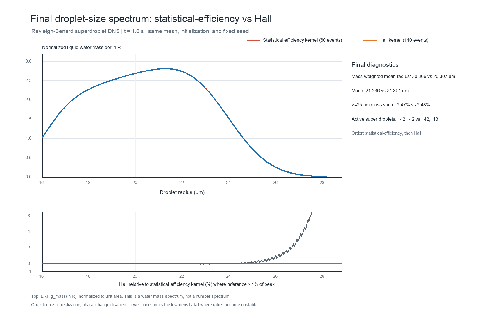
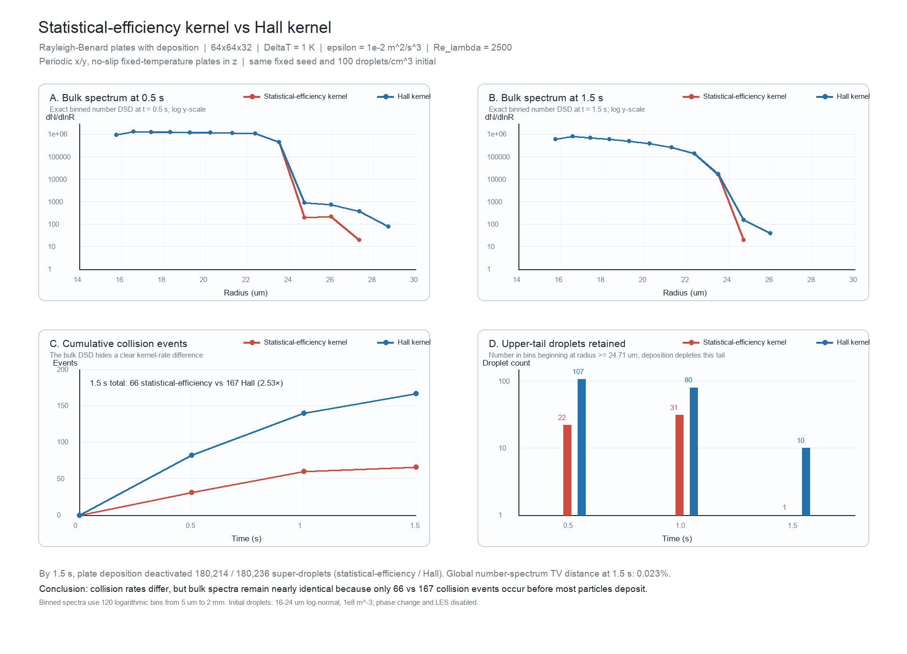

# ERF Rayleigh-Benard superdroplet case

This starter case uses standard Rayleigh-Benard boundaries: periodic horizontal directions and hot/cold no-slip plates. The plate potential-temperature difference is 1 K. It is anelastic, uses molecular viscosity and heat diffusion, and disables LES and PBL closures.

- Domain: 0.2 x 0.2 x 0.1 m, aspect ratio 2 x 2 x 1.
- Grid: 64 x 64 x 32, uniform 3.125 mm spacing.
- Air: T0 about 300 K, rho0 about 1.16 kg/m3.
- nu = 1.81e-5 / 1.16 = 1.56e-5 m2/s; alpha = 2.1e-5 m2/s; Pr about 0.74.
- Ra = g beta deltaT H^3/(nu alpha) about 1.0e5 with beta=1/300 K^-1.
- Superdroplet radii 16-24 um, number concentration 1e8 m-3, two superdroplets per cell.
- Paper collision inputs: epsilon=1e-2 m2/s3, Re_lambda=2500, Brownian term off.

Phase change is disabled for this controlled kernel comparison so the wet radii remain in the published collision-efficiency fit range; particle advection, settling, and coalescence remain active. The two input decks are otherwise identical: the second applies the paper's fitted statistical efficiency to the same ideal pair rate. The radius range stays above the paper fit's 15 um lower limit. The paper epsilon and Re_lambda are prescribed kernel parameters. They do not assert that this RBC flow has those turbulence statistics.

This is a no-SGS direct simulation configuration. The 1 s run and grid are a starter for resolved-convection and coupling checks, not a grid-convergence validation. Check grid and particle sampling convergence before treating averages as physical results.

Run both decks from this directory with the same ERF executable:
~~~sh
/path/to/erf_exec inputs_paper_ideal
/path/to/erf_exec inputs_statistical_efficiency
~~~


## First executed comparison

Both decks completed 1,000 steps to 1.0 s with the particle-enabled 3D ERF executable. Each used the same fixed random seed, mesh, initial droplets, and prescribed paper parameters. The one stochastic realization produced:

- paper_ideal: 1,225 collision events; 141,842 active superdroplets at the final step.
- statistical_efficiency: 60 collision events; 142,142 active superdroplets at the final step.
- Minimum wet radius at the final step: about 16.0 um in both runs.

The statistical-efficiency kernel run produced about 95% fewer collision events than the ideal-kernel run under these settings. Treat this as an execution and coupling check, not a converged collision statistic: repeat with independent seeds and longer averaging before drawing physical conclusions. One second is also shorter than a full free-fall turnover for this box, and grid-convergence checks are still needed.

Plotfiles and full logs from this run are under /tmp/rb_sdm_case/output_paper_ideal_fixedphase, /tmp/rb_sdm_case/output_statistical_efficiency_fixedphase, run_ideal.log, and run_statistical_efficiency.log on the machine where the simulation ran.


## Hall-kernel comparison

`inputs_hall` repeats the `statistical_efficiency` run with the Hall (`Halls`) coalescence kernel. It uses the same 1 s duration, 1 ms timestep, 64 x 64 x 32 grid, Rayleigh-Benard forcing, initial droplet distribution, fixed random seed, and disabled phase change. The kernel selection and plot output path are the only input changes. Run it from this directory with the same particle-enabled ERF executable:

~~~sh
/path/to/erf_exec inputs_hall
~~~

The matched single-seed runs completed 1,000 steps. Hall produced 140 collision events and `statistical_efficiency` produced 60. The final smoothed mass-weighted spectra nearly overlap. Hall's mass-weighted mean radius was 20.307 um versus 20.306 um for `statistical_efficiency`. Their mass-spectrum modes were 21.301 and 21.236 um, respectively. The fraction of the normalized water-mass spectrum at radii >=25 um was 2.484% for Hall and 2.467% for `statistical_efficiency`, a 0.017 percentage-point increase. The maximum logged wet radii were 28.20 um for Hall and 28.35 um for `statistical_efficiency`. Active superdroplet counts were 142,113 and 142,142, respectively.

The figure uses the ERF `g_mass(ln R)` diagnostic (column 2) normalized to unit area. It is a liquid-water mass spectrum, not a number-per-radius distribution. The lower panel shows Hall's relative difference from `statistical_efficiency` only where the latter exceeds 1% of its peak, to avoid an unstable ratio in the sparse tail.



The aligned spectrum values, Hall run logs, histogram diagnostics, and plotfiles are retained in local analysis output under `/tmp/rb_sdm_hall_case` and are not included in version control.

This is one stochastic realization at 1 s with phase change disabled. It shows a higher collision-event count under Hall in this run, while the final mass spectrum changes only slightly. Use independent random seeds, longer averaging, and sampling/grid convergence before attributing robust physical significance to these differences.

## Number-based rerun with plate deposition

To check whether the prior normalized mass-spectrum figure hid the kernel difference, both kernels were rerun for 1.5 s with the same 1 ms step, fixed random seed, Rayleigh-Benard forcing, 16-24 um initial distribution, and particle deposition at the no-slip plates. The diagnostic-enabled build wrote exact binned number spectra every 0.5 s. Only the kernel differs between the two inputs.

| Time | Kernel | Cumulative collisions | Super-droplets deactivated at plates | Total represented droplets | Count in bins starting at >=24.71 um |
|---:|---|---:|---:|---:|---:|
| 0.5 s | statistical_efficiency | 31 | 59,932 | 505,265 | 22 |
| 0.5 s | Hall | 82 | 59,938 | 505,163 | 107 |
| 1.0 s | statistical_efficiency | 60 | 120,116 | 354,425 | 31 |
| 1.0 s | Hall | 140 | 120,145 | 354,283 | 80 |
| 1.5 s | statistical_efficiency | 66 | 180,214 | 203,957 | 1 |
| 1.5 s | Hall | 167 | 180,236 | 203,861 | 10 |

The Hall run has 2.53 times as many logged collision events by 1.5 s. However, about 69% of the initial 262,144 super-droplets have already deposited, and the final total represented droplet counts differ by only 96. The normalized number-spectrum total-variation distance at 1.5 s is 0.0229%. The visible difference is concentrated in the sparse large-radius tail, with 107 versus 22 droplets in bins starting at 24.71 um at 0.5 s. Thus the near-overlap of the full DSD is a real low-exposure result for this baseline, not evidence that the two kernels are identical.

The separate source-formula pair check gives K_statistical-efficiency = 5.335e-12 m3/s and KHall = 2.518e-11 m3/s for a 20/24 um pair at epsilon=1e-2 m2/s3 and Re_lambda=2500. Hall's Stokes-only pair rate is 4.72 times larger. This pair rate is not the bulk DNS outcome: the DNS includes its evolving size distribution, resolved flow velocities, and strong plate deposition.

The number-based comparison figure is [post-processing/compare_dsd_number_statistical_efficiency_vs_hall_rerun.png](post-processing/compare_dsd_number_statistical_efficiency_vs_hall_rerun.png), generated by [post-processing/make_comparison.py](post-processing/make_comparison.py). The pair-rate comparison is `pair_kernel_check.png`, with source-formula values in `pair_kernel_check.csv`. The matched rerun inputs are `inputs_statistical_efficiency_deposition_rerun` and `inputs_hall_deposition_rerun`. Direct simulation-derived CSV data, plotfiles, and logs are retained locally and excluded from version control. The earlier 1 s mass-weighted figure remains above for reference.

To regenerate the number-based figure, provide each run directory containing `run.log` and the binned DSD files for steps 00500, 01000, and 01500:

```sh
python3 post-processing/make_comparison.py \
  --statistical-efficiency-run /path/to/statistical_efficiency_run \
  --hall-run /path/to/hall_run
```

The script requires Python 3, NumPy, and Pillow. It writes the PNG and derived CSV files beside itself by default. Use `--output-dir` to choose another destination.


